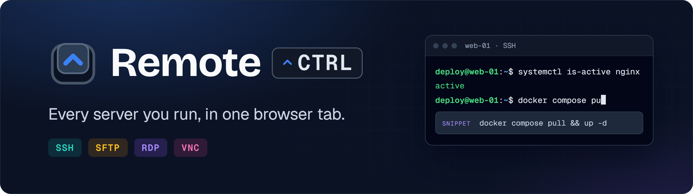
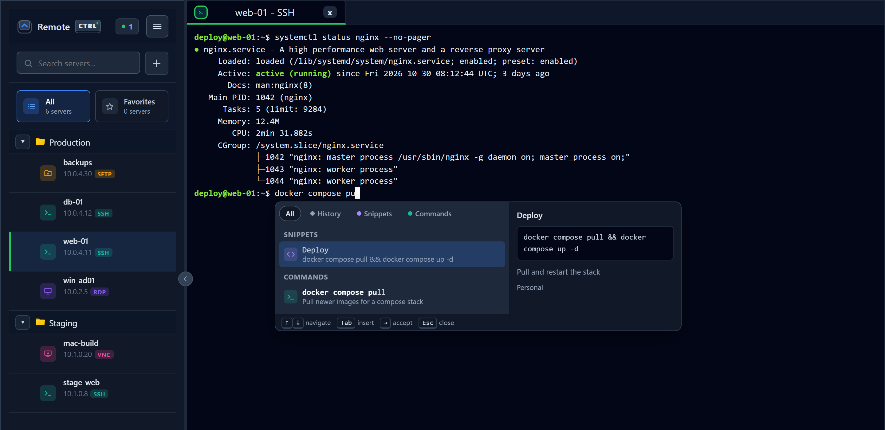

<p align="center">
  
</p>

<p align="center">
  Self-hosted remote access for teams: SSH terminals, SFTP files, and Windows,
  Linux and macOS desktops over RDP and VNC.
</p>

<p align="center">
  <a href="https://remote-ctrl.com">Website</a> ·
  <a href="#install">Install</a> ·
  <a href="https://remote-ctrl.com/pricing">Pricing</a> ·
  <a href="../../releases">Releases</a> ·
  <a href="../../issues">Issues</a>
</p>

<p align="center">
  <a href="../../releases/latest"></a>
  
  
  
</p>

---

Remote CTRL replaces the stack of SSH clients, file managers and remote desktop
apps on every laptop with one place your whole team shares. Install it on your
own server with one Docker image and open it from any browser.

<p align="center">
  
</p>

## Features

| | |
| --- | --- |
| **SSH** | Terminals that remember your commands. As you type, a card suggests commands from this server's history, then every server's, then your saved snippets. |
| **SFTP** | Browse, edit and upload files of any size. Uploads go up in chunks and resume after a dropped connection or a page reload. |
| **RDP** | Windows desktops embedded in the tab, powered by Apache Guacamole inside the same image. |
| **VNC** | Linux screens and macOS Screen Sharing, next to your terminals. |

- **Passwords never reach the browser.** When `sudo` or `ssh` asks for a
  password, pick a saved one: the server types it into the session, and only
  while a prompt is really waiting.
- **Shared folders for each team.** Group servers in folders, share them with a
  team, and keep personal favorites and snippets. Jump hosts are set once per
  server, not on every laptop.
- **AI agents, inside the fence you draw** (paid plans). Connect Claude or any
  MCP client. Each token reaches only the folders you pick, never more than the
  user who created it, and every tool call is logged.
- **Built-in VPN** (paid plans). Reach machines behind NAT or a firewall: each
  one connects out to Remote CTRL with WireGuard, with no ports to open on it.

## Editions

| | Free | Personal | Team and up |
| --- | --- | --- | --- |
| User accounts | 1 | 1 | 10, 25, 50, 250 or custom |
| SSH, SFTP, RDP and VNC | ✓ | ✓ | ✓ |
| Command suggestions, snippets, saved password insertion | ✓ | ✓ | ✓ |
| Resumable uploads, jump hosts | ✓ | ✓ | ✓ |
| AI agents through MCP | | ✓ | ✓ |
| Built-in VPN | | ✓ | ✓ |
| Teams and shared folders | | | ✓ |
| Price | Free, no account needed | [Yearly](https://remote-ctrl.com/pricing) | [Yearly, by tier](https://remote-ctrl.com/pricing) |

Personal unlocks every feature for one user, for personal or professional use.
Every account counts toward the user limit, administrators included. An
administrator activates a license from **About** with a license key; each key
works on one installation at a time.

## Install

You need Docker with Compose on an x86-64 machine (a Linux server, or Docker
Desktop on Windows or an Intel Mac), and network access from it to the servers
you want to reach. Apache Guacamole and its database come in the image. ARM
machines, such as a Raspberry Pi or an Apple Silicon Mac, are not supported
yet. On Windows, run the commands below in WSL or Git Bash.

```sh
curl -fsSLO https://raw.githubusercontent.com/Umberto-Casaburi/remote-ctrl/main/docker-compose.yml
curl -fsSL https://raw.githubusercontent.com/Umberto-Casaburi/remote-ctrl/main/.env.example -o .env
# Replace each CHANGE_ME with a random secret:
for key in APP_SECRET RDP_GUACAMOLE_PASSWORD GUACAMOLE_POSTGRES_PASSWORD; do
  sed -i.bak "s/^$key=CHANGE_ME$/$key=$(openssl rand -hex 32)/" .env
done
rm -f .env.bak
docker compose up -d
```

Open http://localhost:4000 and create the administrator account. To activate a
paid plan, paste your license key in **About**.

> [!IMPORTANT]
> Back up the `remote-ctrl-data` volume together with your `.env`. Saved host
> passwords and keys are encrypted with `APP_SECRET`: without the same value
> they cannot be decrypted.

### Settings

All settings live in `.env`.

| Variable | Purpose |
| --- | --- |
| `APP_SECRET` | Encrypts saved credentials and signs sessions. Required; keep it for the life of the volume. |
| `RDP_GUACAMOLE_PASSWORD` | Password of the internal Guacamole administrator. Required. |
| `GUACAMOLE_POSTGRES_PASSWORD` | Password of the internal Guacamole database. Required. |
| `RDP_GUACAMOLE_USERNAME` | Name of the internal Guacamole administrator. Any name except `guacadmin`. |
| `TRUST_PROXY_HOPS` | Number of reverse proxies in front of Remote CTRL. Set it behind a proxy. |
| `AUTH_COOKIE_SECURE` | Set to `true` when Remote CTRL is served over HTTPS. |
| `RDP_GUACAMOLE_PUBLIC_URL` | Path of the embedded desktops when Remote CTRL runs on a subpath, for example `/remote/guacamole`. |

Remote CTRL refuses to start while a required secret is still `CHANGE_ME`.

### Built-in VPN

Uncomment the VPN lines in `docker-compose.yml`, open UDP port 51820 on the
server, and enable the VPN in **Management > VPN**.

## Update

```sh
docker compose pull
docker compose up -d
```

Release notes are in [Releases](../../releases). To stay on a specific
version, replace `latest` in `docker-compose.yml` with its number, for example
`ghcr.io/umberto-casaburi/remote-ctrl:1.0.0`.

## Reverse proxy

Serve Remote CTRL over HTTPS behind a reverse proxy, forwarding WebSocket
upgrades and the forwarded headers. Example for Nginx on a subpath:

```nginx
location ^~ /remote/ {
  proxy_pass http://127.0.0.1:4000/;
  proxy_http_version 1.1;
  proxy_set_header Host $host;
  proxy_set_header X-Forwarded-Host $host;
  proxy_set_header X-Forwarded-Proto $scheme;
  proxy_set_header X-Forwarded-Prefix /remote;
  proxy_set_header Upgrade $http_upgrade;
  proxy_set_header Connection "upgrade";
  client_max_body_size 32m;
  proxy_request_buffering off;
}
```

Then set in `.env`:

```sh
TRUST_PROXY_HOPS=1
AUTH_COOKIE_SECURE=true
RDP_GUACAMOLE_PUBLIC_URL=/remote/guacamole
```

## Your data stays with you

Hosts, credentials and history live in one Docker volume on your machine, with
saved secrets encrypted. Free runs fully offline. A paid plan sends only its
license key and a random installation ID, once a day, to renew the license.

- SSH host keys are trusted on first use; if a server later presents a
  different key, Remote CTRL refuses to connect until someone who can open that
  host accepts the new key.
- Each user reaches Guacamole through their own account, limited to the
  desktops they can open.
- Hosts owned by non-admin users cannot reach the server's own addresses or
  cloud metadata addresses.

Found a security issue? Write to [info@remote-ctrl.com](mailto:info@remote-ctrl.com)
instead of opening a public issue.

## Support

Report bugs and request features in [Issues](../../issues). For licenses and
quotes, write to [info@remote-ctrl.com](mailto:info@remote-ctrl.com).

## License

Remote CTRL is proprietary software, free for one user. See [LICENSE](LICENSE).
It includes third-party components under their own licenses, listed in
[NOTICE](NOTICE).
